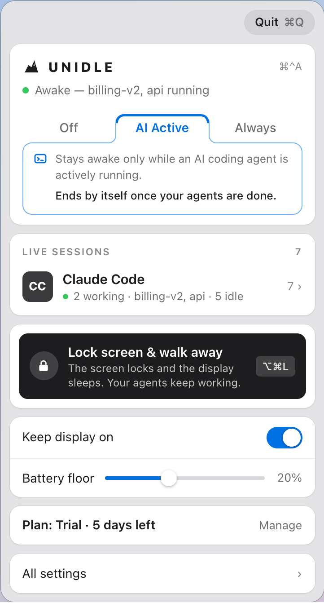

  <picture>
    <source media="(prefers-color-scheme: dark)" srcset="images/panel-dark.png">
    
  </picture>

<h1 align="center">UnIdle</h1>

<b>Your Mac keeps working while your AI coding agent does — through system sleep, a locked screen, even a shut lid on battery — and tells you the moment the agent needs you.</b>

  <a href="https://github.com/rpajaziti/unidle/releases/latest"><b>Download the latest DMG</b></a> ·
  <a href="https://unidle.app">unidle.app</a> ·
  macOS 14+ · Apple Silicon and Intel · free

---

## What it is

UnIdle is a small menu bar app for people who run Claude Code, Codex, Aider, Cursor, Gemini or opencode. Start a long agent run, lock the screen or close the lid, and walk away. UnIdle keeps the Mac awake while the agent works, lets it sleep once the agent is done, and alerts you when the agent finishes or needs your permission.

- **Three modes, one tap.** **AI Active** stays awake only while an agent is working and ends by itself when it's done. **Always** stays awake no matter what, with an optional end time so it can't run all night by accident. **Off** lets your Mac sleep normally; sessions and alerts keep working.
- **Knows, doesn't guess.** For Claude Code, UnIdle hooks into the agent's own lifecycle events, so it knows the moment a task finishes or needs permission. For the other tools it reads local signals together (session log, CPU and network activity), never a single idle connection on its own.
- **Lock and leave.** ⌥⌘L locks the screen and lets the display sleep. Locking never pauses a process; only system sleep does, and that's what UnIdle prevents.
- **Lid shut on battery, only while it matters (Pro).** A small helper, installed with one macOS password prompt, turns lid-close sleep off only while an agent is working. If UnIdle quits or crashes, the helper turns sleep back on at once.
- **Never reads your screen or your code.** No screen-scraping, no terminal contents, no keystrokes stored or sent.

## Install

1. Download `UnIdle.dmg` from [the latest release](https://github.com/rpajaziti/unidle/releases/latest).
2. Open it and drag **UnIdle** to **Applications**.
3. Open UnIdle. Its icon appears in the menu bar, and a short setup walks you through the permissions it needs.

No account. Every release is signed with a Developer ID and notarized by Apple. Updates install themselves through [Sparkle](https://sparkle-project.org/) and keep your permissions.

## Free vs Pro

| | Free | Pro — $12 once |
|---|:---:|:---:|
| Detects 6 agent tools out of the box | ✅ | ✅ |
| AI Active, Always and Off modes | ✅ | ✅ |
| Lock screen & walk away (⌥⌘L) | ✅ | ✅ |
| Battery floor, launch at login | ✅ | ✅ |
| Mac alerts when an agent finishes or needs permission | ✅ | ✅ |
| Keeps running with the lid shut on battery | | ✅ |
| Alerts on your phone, with Approve / Deny (via [ntfy](https://ntfy.sh)) | | ✅ |
| An end time for Always | | ✅ |
| Mouse Motion keep-awake | | ✅ |

**Try every Pro feature free for 7 days**: open UnIdle, then **Start 7-day trial** in Settings. No card, no account. If you don't buy, Free keeps working after the trial.

Pro is a one-time purchase, not a subscription: one licence covers two of your Macs, updates are included, and 30-day refunds are no questions asked. [Buy Pro on unidle.app](https://unidle.app/#pricing).

## Permissions

macOS asks for each one in its own dialog, only when you turn on the feature that needs it.

- **Accessibility** — the global shortcuts (⌥⌘L, ⌘⌃A), Mouse Motion, and on some macOS versions the screen lock.
- **Notifications** — the "finished", "needs permission" and "has a question" alerts.
- **Local Network** (Pro, opt-in) — only for the Approve / Deny buttons on phone alerts.
- **One-time password for the helper** (Pro, opt-in) — only for lid shut on battery.

What each one does and doesn't allow: [unidle.app/permissions](https://unidle.app/permissions.html).

## Privacy

Detection and the awake logic run entirely on your Mac. No account, and no analytics or crash-reporting code inside the app. The only things that leave your Mac:

- **Update checks** to unidle.app/appcast.xml, counted anonymously by version and country. No device identifier.
- **Pro activation**: your licence key, a random ID for this Mac and its name and model, so one key can't run on more Macs than it allows.
- **Phone alerts** (opt-in, off by default): the project folder's name and what happened (e.g. "my-app — finished"), sent through a random private topic on ntfy.sh. Never your code, prompts or commands.

The full list: [unidle.app/privacy](https://unidle.app/privacy.html).

## Uninstall

Open UnIdle's **Settings › General › Uninstall UnIdle…**. It removes the helper, the Claude Code hooks, the login item and its settings, puts your Mac's sleep settings back, and moves the app to the Trash. Dragging the app to the Trash yourself also works: within a day the helper notices the app is gone, turns sleep back on and removes itself, and the Claude Code hooks remove themselves the next time Claude Code starts.

## About this repo

This repo holds the release DMGs ([Releases](https://github.com/rpajaziti/unidle/releases)) and the Sparkle update feed (`appcast.xml`). The app's source isn't public. Questions or bugs: [hello@unidle.app](mailto:hello@unidle.app).

---

UnIdle is not affiliated with Anthropic, OpenAI, Google or any AI agent vendor. Made by [MergeHub](https://mergehub.dev).
